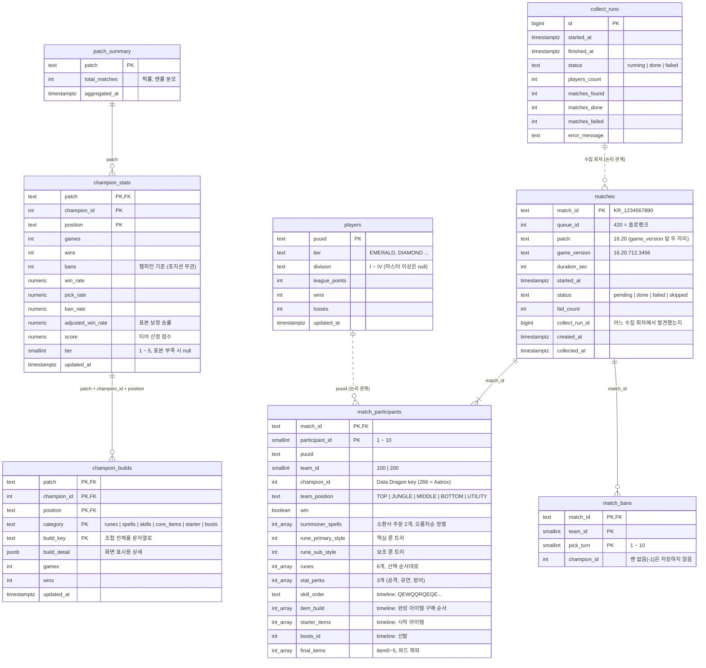

# Tier.GG DB ERD (초안)

- 상태: **초안 (승인 전)**
- DB: Supabase (PostgreSQL)
- 범위: 챔피언 티어리스트(포지션별 1~5티어) + 챔피언 상세 추천(템트리, 룬, 스펠, 스킬빌드)
- 전적 검색, AI 피드백용 테이블은 이번 범위에 포함하지 않는다.

> 요약: 테이블은 **원본(수집한 사실)**, **집계(화면이 읽는 값)**, **운영(수집 기록)** 세 계층으로 나눈다.
> 원본은 Riot API에서 받은 매치 데이터이고, 집계는 원본을 SQL로 묶어 만든다. 화면(API)은 집계 테이블만 읽는다.

---

## 1. 전체 관계도

- 실선(`--`)은 실제 외래키(FK)이고, 점선(`..`)은 FK 없이 값으로만 연결되는 논리 관계다.
- `int_array`는 PostgreSQL의 `int[]`이다. Mermaid 표기 제약으로 이름을 바꿔 적었다.
- `champion_id`는 Data Dragon `champion.json`의 `key`(숫자)다. 챔피언 테이블은 만들지 않고 프론트가 Data Dragon으로 매핑한다.

---

## 2. 계층별 설명

### 2-1. 원본 계층: `players`, `matches`, `match_participants`, `match_bans`

> 요약: Riot API 응답에서 **필요한 값만 뽑아** 저장한다. 다시 수집하지 않아도 집계를 새로 만들 수 있게 한다.

| 테이블 | 한 줄의 의미 | 채우는 API |
|--------|--------------|------------|
| `players` | 수집 대상 플레이어 1명 | `league-v4` entries, challenger/grandmaster/master |
| `matches` | 매치 1개 (수집 상태 포함) | `match-v5 /by-puuid/{puuid}/ids` (ID만), 상세 수집 후 나머지 컬럼 |
| `match_participants` | 매치 1개 안의 참가자 1명 (매치당 10줄) | `match-v5 /matches/{id}` + `/timeline` |
| `match_bans` | 밴 1개 (매치당 최대 10줄) | `match-v5 /matches/{id}` |

- **`players` → `match_participants`에 FK를 걸지 않는 이유**: 참가자 10명 중 `players`에 있는 사람은 일부뿐이다. 수집 대상이 아닌 참가자도 통계에 포함해야 한다.
- **`matches.status`**: 매치 ID를 먼저 `pending`으로 넣고, 상세와 타임라인을 받으면 `done`으로 바꾼다. 실패하면 `failed`와 `fail_count`를 기록해 그것만 다시 시도한다. 다시하기, 조기 항복, 솔로랭크 외 큐는 `skipped`다. 이렇게 해서 예전 방식(매번 `TRUNCATE` 후 전체 재수집)을 대체한다.
- **timeline 원본은 저장하지 않는다.** 한 판에 수백 KB라 무료 플랜(500MB)을 금방 넘는다. `skill_order`, `item_build`, `starter_items`, `boots_id`만 뽑아 저장한다.
- **소환사 주문은 `summoner1Id`, `summoner2Id`에서 가져온다.** 예전 `spell1_casts`는 Q 스킬 사용 횟수였다. 플래시를 D에 두든 F에 두든 같은 조합으로 세도록 오름차순으로 정렬해 저장한다.

### 2-2. 집계 계층: `patch_summary`, `champion_stats`, `champion_builds`

> 요약: 화면이 읽는 값이다. 수집이 끝날 때마다 원본에서 **패치 단위로** 다시 계산해 덮어쓴다.

- **`champion_stats`**: 리스트 화면용이다. 패치 × 챔피언 × 포지션마다 한 줄이다.
  - `tier`는 `score` 구간으로 1~5를 정한다.
  - 표본(`games`)이 기준 미만이면 `null`이다.
- **`champion_builds`**: 상세 화면용이다. **조합 하나가 한 줄**이다.

| category | build_key 예시 | build_detail 예시 |
|----------|----------------|-------------------|
| `runes` | `8000:8010,9111,9104,8299/8400:8444,8453/5008,5008,5001` | `{ primaryStyle, subStyle, perks[], statPerks[] }` |
| `spells` | `4,12` | `{ ids: [4, 12] }` |
| `skills` | `Q>E>W` | `{ maxOrder: "Q>E>W", sequence: ["Q","E","W",...] }` |
| `core_items` | `6692>3071>6694` | `{ items: [6692, 3071, 6694] }` |
| `starter` | `1055,2003` | `{ items: [1055, 2003] }` |
| `boots` | `3047` | `{ itemId: 3047 }` |

- 예전에는 룬과 아이템을 하나씩 따로 세서 상위 N개를 골랐다. 그래서 존재할 수 없는 룬 페이지가 나올 수 있었다. 이번에는 **조합 전체를 키로 묶어 센다.**
- 화면에서는 category별로 `games`가 많은 순서로 상위 몇 개를 보여주고, `wins / games`로 승률을 함께 표시한다.

### 2-3. 운영 계층: `collect_runs`

> 요약: 수집이 언제 돌았고 몇 건 성공, 실패했는지 남긴다.

- 수집 워커가 시작하면 한 줄을 만들고, 끝나면 결과를 기록한다.
- `GET /api/meta`의 "마지막 업데이트 시각"도 이 테이블에서 가져온다.

---

## 3. 인덱스

| 테이블 | 인덱스 | 용도 |
|--------|--------|------|
| `matches` | `(status)` where `status in ('pending','failed')` | 수집할 매치 찾기 |
| `matches` | `(patch)` | 패치별 집계, 오래된 패치 삭제 |
| `match_participants` | `(champion_id, team_position)` | 챔피언 × 포지션 집계 |
| `match_participants` | `(puuid)` | 이후 전적 검색 대비 |
| `champion_stats` | `(patch, position, tier, score desc)` | 포지션별 티어 리스트 |

---

## 4. 보관 정책

- 원본 테이블은 **최근 2개 패치**만 보관한다. 오래된 패치의 `matches`를 지우면 `match_participants`, `match_bans`는 `ON DELETE CASCADE`로 함께 지워진다.
- 집계 테이블은 용량이 작으므로 패치별로 계속 보관한다. 패치 간 비교에 쓸 수 있다.
- 대략적인 용량은 참가자 1줄당 약 0.3KB, 매치당 약 3~4KB다. 10만 판이면 약 400MB로, 무료 플랜 한도에 가깝다.

---

## 5. 보안

- Supabase의 모든 테이블에 **RLS를 켜고 공개 정책은 만들지 않는다.** 브라우저에서 직접 읽을 수 없게 하고, Express 백엔드만 서버용 접속 정보로 읽고 쓴다.
- Riot API 키와 DB 접속 정보는 백엔드 `.env`에만 둔다.

---

## 6. 결정이 필요한 사항

| # | 항목 | 추천안 |
|---|------|--------|
| 1 | 수집 대상 티어 | 에메랄드 이상 |
| 2 | 원본 보관 범위 | 최근 2개 패치 |
| 3 | 티어 표시 최소 표본 | 포지션별 100판 미만이면 티어 없음 |
| 4 | 코어 아이템 기준 | 완성 아이템 3개 구매 순서 |
| 5 | 스킬빌드 기준 | 선마 순서(`Q>E>W`) + 1~15레벨 순서 |
