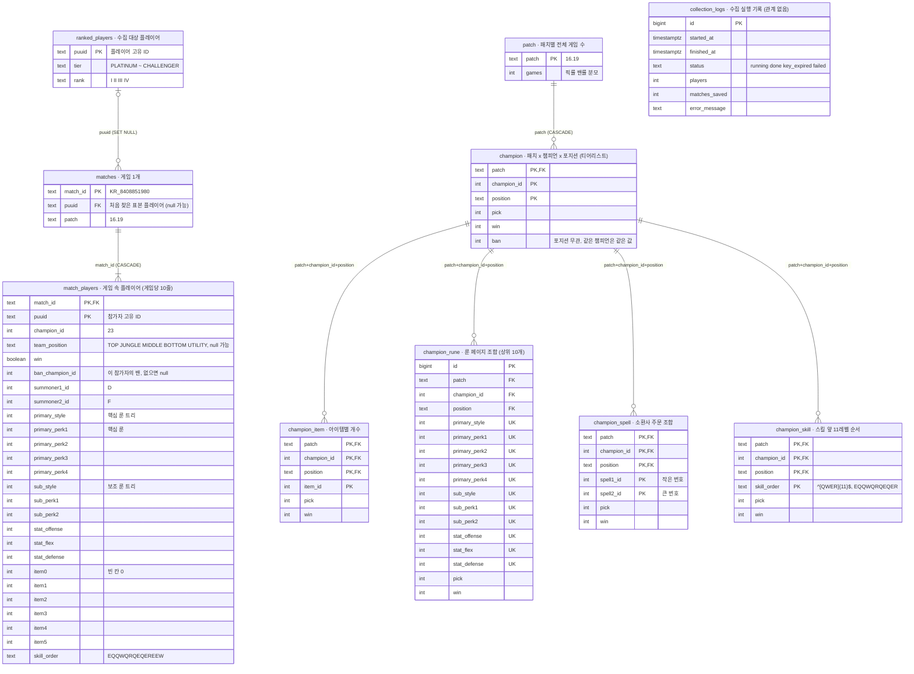

# Tier.GG DB 계약 (DB ↔ 백엔드)

> 이 문서는 `!db`가 작성하고 `!백엔드`가 읽는 계약 문서다. 테이블 구조, 수집 범위, 집계 함수, 저장 규칙을 정한다. (CLAUDE.md 9장)

- 상태: **v6 승인됨 (2026-10-14, 변경 02)**
- 기준: `docs/contracts/db_contract.dbml` (v6, 2026-10-14 변경 02). 이 문서와 dbml이 다르면 dbml이 우선이다.
- DB: Supabase 무료 플랜 (PostgreSQL 17, 500MB)
- 범위: 챔피언 티어리스트(포지션별 1~5티어) + 챔피언 상세 추천(아이템, 룬, 스펠, 스킬)
- 전적 검색과 AI 피드백용 테이블은 이번 범위에 포함하지 않는다.

### v5 → v6 변경 (변경 02, 2026-10-14)

| 변경 | 이유 |
|------|------|
| 수집 범위를 테스트(플래티넘·에메랄드·다이아 각 50명)와 본 수집(에메랄드 이상 4 : 4 : 2)으로 나눔. `ranked_players.tier`에 `PLATINUM` 허용 (마이그레이션 `010_ranked_players_platinum.sql`) | 사용자 결정. 마스터 이상은 디비전이 없어 `entries/{tier}/{division}`으로 고르게 뽑을 수 없으므로 테스트에서 뺌 |
| 집계 직전 `ANALYZE matches, match_players` 규칙 (9-4) | 원본 통계가 틀리면 2만 5천 게임 집계가 3~5분을 넘김. `ANALYZE` 후 5~7초 (db_review M2) |
| `champion_skill.skill_order` CHECK `^[QWER]{11}$`를 문서에 적음 | DB는 v5부터 강제. 문서에 빠져 있었음 (db_review L5) |

### v4 → v5 변경 (변경 01, 2026-10-13)

| 변경 | 이유 |
|------|------|
| `champion_skill`을 앞 11레벨 순서로: 컬럼 `skill_priority` → `skill_order`, `skill_order`가 11자 미만인 줄 제외, 챔피언 × 포지션당 상위 10개 | 사용자 결정. 전체 문자열은 너무 잘게 나뉘고, 앞 11레벨로 고정하면 조합이 모이면서 실제 레벨별 찍는 순서를 보여준다 |
| `skill_priority` 함수 삭제 (D6 ★) | 집계에서 쓰는 곳이 없어짐. 마이그레이션 `009_skill_order_prefix.sql` |

### v3 → v4 변경 요약

| 변경 | 이유 |
|------|------|
| 원본을 최소 컬럼으로 줄임 (`collect_status`, `queue_id`, `game_duration`, `participant_id`, `team_id`, `item6`, 플레이어 LP·승패 등 삭제) | 사용자 간소화안. 수집 조건으로 거르고, 저장은 통계에 쓰는 값만 |
| 룬 배열(`primary_perks`, `sub_perks`)을 정수 컬럼 6개로 펼침 | 배열 없이 단순한 컬럼으로 |
| 타임라인 아이템 컬럼(`start_items`, `boots_id`, `core_items`) 삭제 | 최종 아이템 `item0~5`만 센다. 하위 재료는 프론트가 Data Dragon으로 거른다 |
| 집계 테이블은 개수(pick, win, ban)만 저장 | 승률·픽률·밴률·티어는 조회할 때 계산 (공식이 바뀌어도 재집계가 필요 없음) |
| 테이블 이름 단수형 (`patch`, `champion`, `champion_item` …) | dbml v4 |

---

## 1. 수집 범위

> 요약: KR 서버 **솔로랭크**, **최근 2개 패치**의 게임만 모은다. 첫 실제 수집(**테스트**)은 **플래티넘·에메랄드·다이아 각 50명**, **본 수집**은 **에메랄드 이상**이다. 패치당 최대 **2만 5천 게임**이다.

### 1-1. 수집 기준

| 항목 | 기준 | 이유 |
|------|------|------|
| 서버 | KR | 한국 서비스 |
| 큐 | 솔로랭크. 게임 ID 목록을 `queue=420`으로 요청 | 일반·자유랭크는 실력·조합 편차가 큼. DB에는 큐 컬럼이 없으므로 요청 단계에서 거른다 |
| 티어 | 테스트: 플래티넘·에메랄드·다이아 각 50명 (1-3). 본 수집: 에메랄드 이상 (에메랄드 : 다이아 : 마스터 이상 = 4 : 4 : 2, 테스트 뒤 다시 정함) | 표본 품질. 한 티어에 몰리지 않게 비율 고정 |
| 원본 보관 | **최근 2개 패치**만 | 무료 용량. 오래된 원본은 `purge_old_patches`로 삭제 |
| 패치당 게임 수 | 최대 25,000게임 | 아래 용량 계산 기준 |
| 플레이어당 게임 수 | 최대 20게임 (권장) | 원챔 장인 한 명이 통계를 좌우하지 않게 |
| 제외 게임 | `gameDuration < 300`(5분 미만, 다시하기) | 정상 게임이 아님. **저장하지 않는다** |
| 저장 필드 | 참가자 1명당 26개 컬럼 | 티어와 추천에 필요한 값만 (6장) |
| 타임라인 원본 | 저장하지 않음 | 한 판 약 570KB. 스킬 순서만 뽑아 `skill_order`에 저장 |
| 집계 결과 | 모든 패치 계속 보관 | 패치당 약 4MB |

- `ranked_players.tier` 허용 값: `PLATINUM`, `EMERALD`, `DIAMOND`, `MASTER`, `GRANDMASTER`, `CHALLENGER` (CHECK `ranked_players_tier_check`). `IRON`~`GOLD`는 저장할 수 없다.

### 1-2. 용량 계산 (패치당 25,000게임 × 2개 패치)

| 테이블 | 줄 수 | 1줄 크기 (인덱스 포함, 대략) | 용량 |
|--------|-------|------------------------------|------|
| `match_players` | 50만 | 약 400B (본문 약 250B + PK 인덱스 약 120B + 챔피언 인덱스 약 30B) | 약 200MB |
| `matches` | 5만 | 약 180B (`puuid` 78자 포함 + PK) | 약 9MB |
| `ranked_players` | 약 5천 | 약 150B | 약 1MB |
| 집계 테이블 6개 | 패치당 약 3만 줄 | - | 패치당 약 4MB |
| **합계 (시작)** | | | **약 220MB / 500MB** |
| 합계 (1년, 집계 약 25패치 누적) | | | 약 310MB / 500MB |

- v3(약 315MB)보다 원본 1줄이 작아져(약 560B → 약 400B) 시작 용량이 약 100MB 줄었다.
- `match_players`에서 가장 큰 것은 `puuid`(78자)다. 본문과 PK 인덱스에 두 번 들어간다.
- PostgreSQL은 삭제 후 바로 공간을 돌려주지 않는다(autovacuum이 재사용). 실제 사용량은 계산보다 커질 수 있어 약 180MB를 여유로 둔다.
- 25,000게임이면 참가자 25만 줄, 챔피언 × 포지션당 평균 약 1,000판이다.
- 개발 키 기준 속도: 게임 1개 = `getMatch` + `timeline` 2회 호출. 2분 100회 제한이면 시간당 약 1,500게임, 25,000게임은 약 17시간이다.

### 1-3. 개발 단계 운영 (테스트 수집)

- 첫 실제 수집은 **테스트 수집**으로 수집 → 저장 → 집계 → 화면 흐름을 검증한다.
- 표본: **플래티넘·에메랄드·다이아 각 50명, 모두 150명.** 각 티어에서 디비전 I~IV에 12~13명씩 고르게 고른다. `league-v4` `/lol/league/v4/entries/RANKED_SOLO_5x5/{tier}/{division}`만 쓴다.
- 마스터·그랜드마스터·챌린저는 디비전이 없어 같은 방식으로 고르게 뽑을 수 없으므로 테스트에서 뺀다. 본 수집 때 별도 리그 API로 다시 정한다.
- 예상 규모: 약 2,700게임 (150명 × 최대 20게임, 겹침 제외), 개발 키로 약 2시간, 약 12MB. 챔피언 × 포지션당 평균 약 30판이라 티어는 대부분 NULL("표본 부족")이다.
- 티어·디비전별 인원, 디비전 안에서 고르는 방법, 플레이어당 게임 수는 **백엔드 수집기 설정**이다. DB는 허용 값(1-1)만 확인한다.
- 개발 키(24시간 만료)를 사용자가 매일 직접 발급해 `.env`에 넣고, 수집은 명령어로 직접 실행한다.
- 키가 만료되면(401/403) 수집을 멈추고 `collection_logs.status = 'key_expired'`로 기록한다.

### 1-4. 무료 플랜 주의사항

- 7일 동안 사용이 없으면 프로젝트가 일시정지된다. 대시보드에서 다시 켤 수 있다.
- 월 전송량 한도(5GB)가 있다. 화면은 집계 테이블만 읽고 Next.js가 캐시하므로 영향이 작다.

---

## 2. 테이블 목록

> 요약: 테이블 10개를 세 묶음으로 나눈다. **원본**(Riot 값 그대로), **집계**(원본을 센 개수, 화면이 읽음), **운영**(수집 기록)이다.

| 묶음 | 테이블 | 한 줄의 의미 | 설명 |
|------|--------|--------------|------|
| 원본 | `ranked_players` | 플레이어 1명 | 수집 대상 표본(테스트: 플래티넘~다이아, 본 수집: 에메랄드 이상). 이 사람들의 게임 ID를 찾는다 |
| 원본 | `matches` | 게임 1개 | 게임 ID, 찾을 때 쓴 표본 플레이어, 패치 |
| 원본 | `match_players` | 게임 속 플레이어 1명 | **핵심.** 게임당 10줄. 챔피언, 포지션, 승패, 밴, 스펠, 룬, 최종 아이템, 스킬 순서 |
| 집계 | `patch` | 패치 1개 | 그 패치의 전체 게임 수 (픽률·밴률 분모) |
| 집계 | `champion` | 패치 × 챔피언 × 포지션 | pick, win, ban 개수. **티어리스트 화면** |
| 집계 | `champion_item` | 아이템 1개 | 그 아이템을 가지고 끝난 게임 수. **상세 화면** |
| 집계 | `champion_rune` | 룬 페이지 조합 1개 | 트리 2개 + 룬 6개 + 파편 3개가 같은 조합. **상세 화면** |
| 집계 | `champion_spell` | 소환사 주문 조합 1개 | 작은 번호 + 큰 번호. **상세 화면** |
| 집계 | `champion_skill` | 스킬 찍은 순서 앞 11레벨 1개 | `EQQWQRQEQER` 형식. **상세 화면** |
| 운영 | `collection_logs` | 수집 실행 1회 | 언제 돌았고 몇 게임 저장했는지, 키 만료로 멈췄는지 |

- 이 밖에 마이그레이션 실행기가 쓰는 메타 테이블 `schema_migrations`(적용한 SQL 파일 기록)가 있다. 수집·집계와 관계없다.
- 챔피언·아이템·룬·스펠 이름과 이미지는 저장하지 않는다. 모든 ID는 Data Dragon 값이고, 프론트가 Data Dragon으로 표시한다.

---

## 3. 테이블 관계

> 요약: 원본은 수집 순서대로 `ranked_players` → `matches` → `match_players`, 집계는 `patch` → `champion` → 상세 4개로 이어진다. 원본과 집계는 FK로 잇지 않고, 집계 SQL 함수가 원본을 읽어 집계를 다시 만든다.

| 관계 | 종류 | 삭제 동작 | 설명 |
|------|------|-----------|------|
| `ranked_players` 1 : N `matches` | FK `matches.puuid` | ON DELETE SET NULL | 이 게임 ID를 어느 표본 플레이어 목록에서 처음 찾았는지 |
| `matches` 1 : N `match_players` | FK `match_players.match_id` | ON DELETE CASCADE | 게임 1개에 10줄. 게임을 지우면 함께 삭제 |
| `patch` 1 : N `champion` | FK `champion.patch` | ON DELETE CASCADE | 패치 1개에 챔피언 × 포지션 여러 줄 |
| `champion` 1 : N `champion_item` / `champion_rune` / `champion_spell` / `champion_skill` | FK `(patch, champion_id, position)` | ON DELETE CASCADE | 챔피언 × 포지션 1개에 추천 조합 여러 개 |
| `collection_logs` | 관계 없음 | - | 실행 기록일 뿐 통계와 무관 |

- `match_players.puuid`는 참가자 10명의 puuid다. 표본 플레이어가 아닌 사람도 있으므로 `ranked_players`와 잇지 않는다.
- `patch` 1줄을 지우면 그 패치의 집계 5개 테이블이 모두 CASCADE로 지워진다. 집계 함수는 이 성질을 이용해 다시 만든다.

---

## 4. ERD

> 요약: dbml v6을 Mermaid로 옮긴 그림이다. 각 테이블 이름 옆에 설명을 붙였다.

- `champion_rune`의 `UK`는 `(patch, champion_id, position, 룬 11개)` 전체에 걸린 유니크 키 1개다.

---

## 5. 데이터 흐름

> 요약: 플레이어 목록 → 게임 ID → 게임 상세 → 타임라인 순으로 Riot을 부르고, 한 게임은 한 번에 저장한다. 마지막에 집계 함수 한 번으로 화면용 테이블을 만든다.

| 단계 | Riot API / SQL | 하는 일 | 채우는 곳 |
|------|----------------|---------|-----------|
| ① | `league-v4` `/lol/league/v4/entries/RANKED_SOLO_5x5/{tier}/{division}` (테스트: 플래티넘·에메랄드·다이아, 본 수집: 에메랄드·다이아), 마스터 이상은 `league-v4` `masterleagues`·`grandmasterleagues`·`challengerleagues` `/by-queue/RANKED_SOLO_5x5` | 티어·디비전별 인원은 백엔드 수집기 설정 (1-1, 1-3) | `ranked_players` (upsert) |
| ② | `match-v5` `/lol/match/v5/matches/by-puuid/{puuid}/ids?queue=420` | 솔로랭크 게임 ID 목록. 이미 `matches`에 있는 ID는 건너뜀 | (메모리, 아직 저장 안 함) |
| ③ | `match-v5` `/lol/match/v5/matches/{matchId}` | 패치, 참가자 10명, 밴 | (메모리) |
| ④ | `match-v5` `/lol/match/v5/matches/{matchId}/timeline` | `SKILL_LEVEL_UP` 이벤트로 스킬 순서 | (메모리) |
| ⑤ | DB 트랜잭션 1개 | ③④가 모두 성공하고 5분 이상 게임이면 `matches` 1줄 + `match_players` 10줄을 **한 번에** 저장 | `matches`, `match_players` |
| ⑥ | `ANALYZE matches, match_players` → `SELECT refresh_patch_stats('16.19')` | 원본 통계를 새로 고친 뒤 패치 전체를 처음부터 다시 셈 (9-4) | 집계 6개 |
| ⑦ | `SELECT purge_old_patches(2)` | 최신 2개 패치보다 오래된 원본 삭제 | `matches`(+`match_players` CASCADE) |

- 수집 실행 1회마다 `collection_logs`에 1줄을 남긴다 (`running`으로 시작 → `done`/`key_expired`/`failed`로 끝냄).
- **게임 완료 기준:** `match_players`가 10줄인 게임만 완료로 본다. 집계 함수는 10줄이 아닌 게임을 세지 않는다. 그래서 ⑤를 한 트랜잭션으로 하면 중간에 멈춰도 반쪽 게임이 남지 않는다.
- ③에서 나온 참가자를 ①의 수집 대상으로 다시 넣지 않는다 (데이터가 눈덩이처럼 불어남).
- ⑥은 ⑦보다 먼저 한다. 원본을 지운 패치는 다시 집계할 수 없다.

---

## 6. Riot 필드 매핑

> 요약: 원본 컬럼이 Riot 응답 어디에서 오는지와 실제 게임 `KR_8408851980`(패치 16.19, 솔로랭크, 1295초)의 1번 참가자(트린다미어, 탑, 승리) 값이다.

### 6-1. `ranked_players` (league-v4)

| 컬럼 | JSON 경로 | 예시 값 |
|------|-----------|---------|
| `puuid` | `puuid` (마스터 이상은 `entries[].puuid`) | (78자 문자열) |
| `tier` | `tier` (마스터 이상은 리스트 최상위 `tier`). 허용 값은 1-1 | `EMERALD` |
| `rank` | `rank` (마스터 이상도 Riot 값 `I` 그대로) | `II` |

### 6-2. `matches` (getMatch)

| 컬럼 | JSON 경로 | 예시 값 | 변환 |
|------|-----------|---------|------|
| `match_id` | `metadata.matchId` | `KR_8408851980` | |
| `puuid` | (②에서 조회한 표본 플레이어) | (78자 문자열) | 이미 다른 플레이어로 저장된 게임이면 그대로 둠 |
| `patch` | `info.gameVersion` 앞 두 부분 | `16.19.823.722` → `16.19` | 파생 |

### 6-3. `match_players` (getMatch `info.participants[]` + timeline)

| 컬럼 | JSON 경로 | 예시 값 |
|------|-----------|---------|
| `match_id` | `metadata.matchId` | `KR_8408851980` |
| `puuid` | `participants[].puuid` | (78자 문자열) |
| `champion_id` | `participants[].championId` | `23` |
| `team_position` | `participants[].teamPosition` | `TOP` |
| `win` | `participants[].win` | `true` |
| `ban_champion_id` | `info.teams[].bans[]` 중 `pickTurn = participants[].participantId`인 항목의 `championId` | `64` (`teams[0].bans`, pickTurn 1 = participantId 1) |
| `summoner1_id` | `participants[].summoner1Id` | `14` |
| `summoner2_id` | `participants[].summoner2Id` | `4` |
| `primary_style` | `perks.styles[0].style` | `8100` |
| `primary_perk1` ~ `primary_perk4` | `perks.styles[0].selections[0..3].perk` | `9923`, `8143`, `8140`, `8135` |
| `sub_style` | `perks.styles[1].style` | `8000` |
| `sub_perk1`, `sub_perk2` | `perks.styles[1].selections[0..1].perk` | `8299`, `9104` |
| `stat_offense` | `perks.statPerks.offense` | `5008` |
| `stat_flex` | `perks.statPerks.flex` | `5008` |
| `stat_defense` | `perks.statPerks.defense` | `5011` |
| `item0` ~ `item5` | `participants[].item0` ~ `item5` | `1018`, `3074`, `3006`, `3046`, `1036`, `1036` |
| `skill_order` | timeline `info.frames[].events[]` 중 `type = SKILL_LEVEL_UP`, `participantId = 1`의 `skillSlot` | `EQQWQRQEQEREEW` |

- 저장하지 않는 값: `item6`(장신구, 예시 `3340`), `queueId`(요청에서 420으로 거름), `gameDuration`(5분 미만이면 저장 안 함, 예시 `1295`).
- `perks.styles[0]`/`[1]`은 각 항목의 `description`(`primaryStyle`/`subStyle`)으로 한 번 더 확인한다.

---

## 7. 백엔드 저장 규칙

> 요약: DB의 CHECK와 집계 함수가 기대하는 저장 형식이다. 이 규칙을 어기면 INSERT가 실패하거나 집계가 틀어진다.

| 항목 | 규칙 |
|------|------|
| 큐 | 게임 ID 목록을 `queue=420`으로만 요청. DB는 큐를 다시 확인하지 않는다 |
| 5분 미만 | `info.gameDuration < 300`이면 `matches`·`match_players` 모두 저장하지 않는다 |
| 패치 | `info.gameVersion`을 `.`으로 나눈 앞 두 부분 (`16.19.823.722` → `16.19`). 형식 `^[0-9]+\.[0-9]+$` |
| 보관 패치 밖 게임 | 최신 2개 패치보다 오래된 패치의 게임은 저장하지 않는다 (권장) |
| 한 게임 저장 | `getMatch`와 `timeline`이 모두 성공한 뒤 `matches` 1줄 + `match_players` 10줄을 트랜잭션 1개로 저장. 하나라도 실패하면 저장하지 않고 다음 실행에서 다시 시도 |
| 중복 게임 | `match_id`가 이미 있으면 건너뜀 (`ON CONFLICT DO NOTHING`) |
| `team_position` | Riot 빈 문자열 `""`은 NULL |
| `ban_champion_id` | `info.teams[].bans[]`에서 `pickTurn = participantId`인 항목의 `championId`. `-1`(밴 없음)이거나 짝이 없으면 NULL. 짝이 없으면 수집 로그에 경고 |
| 스펠 | `summoner1Id`/`summoner2Id`는 Riot 값 그대로 저장 (D/F 위치 유지). 정렬은 집계 함수가 한다 |
| 룬 | `perks.styles[0]` = 핵심, `[1]` = 보조. 선택 룬은 `selections` 순서 그대로 |
| 아이템 | `item0`~`item5`는 Riot 값 그대로. 빈 칸은 `0` (NULL 아님). 같은 아이템 2개도 그대로 |
| `skill_order` | timeline `SKILL_LEVEL_UP` 중 그 참가자의 `levelUpType = 'NORMAL'` 이벤트만(카이사 등의 `EVOLVE` 제외), `timestamp` 순, `skillSlot` 1→`Q` 2→`W` 3→`E` 4→`R`로 이어 붙임. 허용 형식 `^[QWER]*$` |
| `ranked_players` | `rank`는 Riot 값 그대로. 표본 갱신은 upsert |
| 키 만료 | 401/403이면 즉시 멈추고 `collection_logs.status = 'key_expired'`, `finished_at` 기록 |
| 집계 호출 | `refresh_patch_stats` 직전에 같은 연결에서 `ANALYZE matches, match_players`를 실행한다 (9-4) |

- **알려진 한계:** 밴 ↔ 참가자 연결(`pickTurn` 1~5 = `participantId` 1~5, 6~10 = 6~10)은 실제 응답에서 관찰한 규칙이며 Riot 문서에 명시되어 있지 않다. 밴률 합계(챔피언이 밴된 게임 수)는 누가 밴했는지와 무관하다.

---

## 8. 인덱스

> 요약: PK·유니크 키 외에 dbml에 있는 인덱스 1개만 만든다.

| 테이블 | 인덱스 | 종류 | 용도 |
|--------|--------|------|------|
| `match_players` | `(match_id, puuid)` | PK | 게임별 참가자 조회, 게임 완료(10줄) 확인 |
| `match_players` | `(champion_id, team_position)` | 일반 | 챔피언 × 포지션 조회 |
| `champion` 등 집계 5개 | `(patch, champion_id, position, …)` | PK | 패치별 티어리스트, 챔피언 상세 조회 |
| `champion_rune` | `(patch, champion_id, position, 룬 11개)` | 유니크 | 같은 룬 페이지는 1줄 |

- 만들지 않는 인덱스: `matches.patch`, `matches.puuid`, `match_players.puuid`. `matches`는 최대 5만 줄이라 순차 스캔이 빠르고, 나머지는 이번 범위에 조회가 없다. 전적 검색을 만들 때 추가한다.

---

## 9. 집계 SQL 함수

> 요약: 백엔드는 `SELECT refresh_patch_stats('16.19')`로 그 패치의 집계를 다시 만들기 전에 `ANALYZE matches, match_players`를 먼저 실행하고, `SELECT purge_old_patches(2)`로 오래된 원본을 지운다. 비율과 티어는 저장하지 않고 조회할 때 계산한다.

### 9-1. 함수 목록

| 함수 | 반환 | 하는 일 |
|------|------|---------|
| `refresh_patch_stats(p_patch text)` | jsonb `{patch, games, champion_rows, item_rows, rune_rows, spell_rows, skill_rows}` | 그 패치의 집계 6개를 한 트랜잭션 안에서 지우고 다시 센다. 완료된 원본 게임이 0개면 **오류**(기존 집계 보존) |
| `purge_old_patches(p_keep int DEFAULT 2)` | int (삭제한 게임 수) | 최신 `p_keep`개 패치보다 오래된 `matches` 삭제(`match_players` CASCADE). 집계는 남김 |
| `patch_sort_key(p_patch text)` | int[] | `'16.9'` → `{16,9}`. 패치 순서는 항상 이 값으로 비교 (문자열 정렬이면 `16.9 > 16.19`가 됨) |
| `tier_from_score(p_score numeric)` | smallint | 점수로 1~5티어 (9-3) |

- 모든 함수와 뷰는 DB 주인 계정(백엔드)만 실행·조회할 수 있다 (11장).

### 9-2. `refresh_patch_stats` 계산 규칙

| 값 | 정의 |
|----|------|
| 대상 게임 | `matches.patch = p_patch`이고 `match_players`가 정확히 10줄인 게임 |
| `patch.games` | 대상 게임 수 |
| `champion.pick` / `win` | 대상 게임의 `match_players` 중 `team_position IS NOT NULL`, 챔피언 × 포지션별 줄 수 / 그중 `win = true` |
| `champion.ban` | 대상 게임 중 `ban_champion_id = 그 챔피언`인 **게임 수** (`count(DISTINCT match_id)`, 양 팀이 같은 챔피언을 밴해도 1번). 포지션과 무관하게 같은 값 |
| `champion_item` | 각 줄의 `item0`~`item5` 중 `0`(빈 칸)과 NULL을 빼고, **한 줄 안의 중복은 1번만** 센다 (예시의 `1036` 2개 → 1). 하위 재료도 포함. **모든 아이템 저장** |
| `champion_rune` | 트리 2개 + 룬 6개 + 파편 3개가 모두 같은 조합끼리 센다. 챔피언 × 포지션마다 **상위 10개** |
| `champion_spell` | `spell1_id = least(summoner1_id, summoner2_id)`, `spell2_id = greatest(…)`. 두 주문이 같은 줄(`summoner1_id = summoner2_id`)은 뺀다. **상위 10개** |
| `champion_skill` | `skill_order`가 11자 이상인 줄만(NULL·빈 문자열·10자 이하 제외), `left(skill_order, 11)`로 묶는다 (예: `EQQWQRQEQEREEW` → `EQQWQRQEQER`). **상위 10개** (v5, 변경 01. v4의 "`skill_priority`가 NULL이 아닌 줄만, 모두 저장"(D3)을 대체). 저장 형식은 CHECK `champion_skill_skill_order_check`: `skill_order ~ '^[QWER]{11}$'` (Q·W·E·R 정확히 11자). |

- 상위 N개 정렬: `pick` 내림차순 → `win` 내림차순 → 조합 키 오름차순 (결과가 매번 같게).
- 포지션이 NULL인 줄은 픽·상세 집계에서 빠지지만 `patch.games`와 `ban`에는 포함된다.
- 밴만 되고 픽이 한 번도 없는 챔피언은 `champion` 줄이 없어서 밴률이 표시되지 않는다 (한계).

### 9-3. 비율과 티어 (조회할 때 계산)

| 값 | 공식 |
|----|------|
| 승률 | `100 × win / pick` |
| 픽률 | `100 × pick / patch.games` |
| 밴률 | `100 × ban / patch.games` |
| 보정 승률 | `100 × (win + 50) / (pick + 100)` (승률 50% 가상 게임 100판을 더한 베이지안 보정) |
| 티어 점수 | `보정 승률 + 0.10 × least(픽률, 20) + 0.03 × least(밴률, 30)` |
| 티어 | `pick < 50`이면 NULL("표본 부족"). 아니면 1: ≥ 53.0, 2: ≥ 51.5, 3: ≥ 50.0, 4: ≥ 48.5, 5: 그 미만 |

- **계산 위치: DB 뷰 `champion_tier_view` (db_spec D1 = (a), 2026-10-13 승인).** 백엔드는 공식을 다시 구현하지 않고 이 뷰를 `SELECT`만 한다. `security_invoker = true`, `anon`·`authenticated` 권한 없음.

| 뷰 컬럼 | 타입 | 정의 |
|---------|------|------|
| `patch`, `champion_id`, `position`, `pick`, `win`, `ban` | `champion`과 같음 | `champion` 그대로 |
| `games` | int | `patch.games` |
| `win_rate` | numeric | `round(100.0 × win / pick, 2)` |
| `pick_rate` | numeric | `round(100.0 × pick / games, 2)` |
| `ban_rate` | numeric | `round(100.0 × ban / games, 2)` |
| `adjusted_win_rate` | numeric | `round(100.0 × (win + 50) / (pick + 100), 2)` |
| `tier_score` | numeric | `round(티어 점수, 3)`. 점수는 반올림 전 비율로 계산 |
| `tier` | smallint | `pick < 50`이면 NULL, 아니면 `tier_from_score(반올림 전 점수)` 1~5 |

- 사용 예: `SELECT * FROM champion_tier_view WHERE patch = $1 AND position = $2 ORDER BY tier NULLS LAST, tier_score DESC`.
- 기준값(50판, 100판, 0.10, 0.03, 경계값)은 뷰와 `tier_from_score`에만 있다. 바꿀 때는 `!db`가 새 마이그레이션으로 바꾼다.
- 상세 테이블의 비율(조합 승률 = `win / pick`, 조합 사용률 = `pick / champion.pick`)은 단순 나눗셈이라 백엔드가 계산한다.
- 주 포지션: 챔피언별 pick이 많은 순서로 최대 2개. 2순위는 그 챔피언 전체 pick의 10% 이상일 때만 표시. **백엔드 API가 적용한다.**
- 화면 패치 선택(새 패치 초반에 직전 패치 대체)도 백엔드가 정한다. 패치 순서는 `ORDER BY patch_sort_key(patch) DESC`.

### 9-4. 백엔드 호출 규칙

> 요약: 집계 직전에 원본 두 테이블의 통계를 새로 고친다. 통계가 틀리면 같은 집계가 5초에서 5분 이상으로 늘어난다.

| 순서 | SQL | 이유 |
|------|-----|------|
| 1 | `ANALYZE matches, match_players` | 대량 수집·삭제 직후 통계가 "페이지는 있는데 줄은 0개"로 남으면 플래너가 원본을 1줄로 보고 느린 Nested Loop를 고른다. 2만 5천 게임에서 집계가 3~5분을 넘겼고, `ANALYZE` 후 5~7초였다 (db_review M2). `ANALYZE` 자체는 0.35~3.3초 |
| 2 | `SELECT refresh_patch_stats($1)` | 패치마다 1번. 여러 패치면 1번의 `ANALYZE` 뒤에 차례로 |
| 3 | `SELECT purge_old_patches(2)` | 집계를 마친 뒤 (5장 ⑦) |

- 1과 2는 같은 연결에서 실행한다. 트랜잭션 안이어도 된다 (`ANALYZE`는 `VACUUM`과 달리 트랜잭션 안에서 실행 가능).
- `ANALYZE`는 테이블 주인(또는 `MAINTAIN` 권한) 역할만 실행할 수 있다. 백엔드는 테이블 주인 계정으로 접속하므로 그대로 쓴다 (11장).
- 집계 호출 연결은 `SET statement_timeout`을 넉넉히(예: 5분) 둔다.
- 함수 안의 임시 테이블만 `ANALYZE`하는 방식은 효과가 없었다 (느린 문장이 원본 조인 자체이기 때문).

---

## 10. 확정 사항

> 요약: 사용자가 정한 것들이다. 바꾸려면 다시 승인을 받는다.

| # | 항목 | 결정 |
|---|------|------|
| 1 | Supabase 프로젝트 | 생성 완료 (무료 플랜, 500MB) |
| 2 | 수집 티어 | 테스트: 플래티넘·에메랄드·다이아 각 50명, 디비전 I~IV 고르게 (변경 02). 본 수집: 에메랄드 이상 4 : 4 : 2 (테스트 뒤 다시 정함) |
| 3 | 티어 표시 최소 표본 | 챔피언 × 포지션 **50판** 미만이면 티어 NULL ("표본 부족") |
| 4 | 새 패치 초반 표시 | 현재 패치 표본이 기준 미만이면 직전 패치 통계를 보여주고 기준 패치를 표시 (백엔드) |
| 5 | 추천 개수 | 화면에는 카테고리별 상위 2개 (프론트 작업 때 조정 가능) |
| 6 | 원본 보관 | 최근 2개 패치 |
| 7 | 스키마 | dbml v6 (원본 3, 집계 6, 운영 1. 테이블 구성은 v4·v5와 같음). 집계는 개수만, 비율·티어는 조회할 때 계산 |
| 8 | 아이템 | `item0~5` 모든 아이템을 센다. 하위 재료는 프론트가 Data Dragon으로 거른다. 아이템 테이블 없음 |
| 9 | 주 포지션 | 최대 2개, 2순위는 10% 이상일 때만 (백엔드) |
| 10 | 운영 | 개발 키 24시간마다 수동 재발급, 수집은 수동 실행 |
| 11 | 스킬 집계 | 원본 스킬 순서 앞 11레벨, 11자 미만 제외, 챔피언 × 포지션당 상위 10개 (변경 01) |
| 12 | 집계 전 통계 | 백엔드가 `refresh_patch_stats` 직전에 `ANALYZE matches, match_players` (변경 02, M2) |

---

## 11. 보안

> 요약: 브라우저용 키로는 아무것도 읽을 수 없다. Express 백엔드만 서버용 접속 정보(테이블 주인 계정)로 읽고 쓴다.

- 모든 테이블(`schema_migrations` 포함)에 RLS를 켜고 **정책은 하나도 만들지 않는다**.
- `anon`, `authenticated` 역할의 테이블·뷰 권한을 회수한다 (`REVOKE ALL`).
- 함수 실행 권한을 `PUBLIC`, `anon`, `authenticated`에서 회수한다 (Supabase는 public 함수를 RPC로 노출하므로).
- 뷰를 만들면 `security_invoker = true`로 만들어 RLS를 우회하지 않게 한다.
- Riot API 키와 DB 접속 정보는 루트 `.env`에만 둔다. 값은 문서·로그·커밋에 출력하지 않는다.
